# TVBox TV App

基于 TVBox JSON 配置与 Java Spider ABI 的 Android TV 客户端。界面会按电视
分辨率、逻辑密度、宽高比、系统安全区和字号自适应，并针对遥控器操作设计。

当前版本：`1.1.0`

开源仓库：<https://github.com/ch4nhm/tvbox-tv>

## 界面预览

### 首页与继续观看

首页保留继续观看与精选推荐；没有播放历史时不会展示空的历史区域。

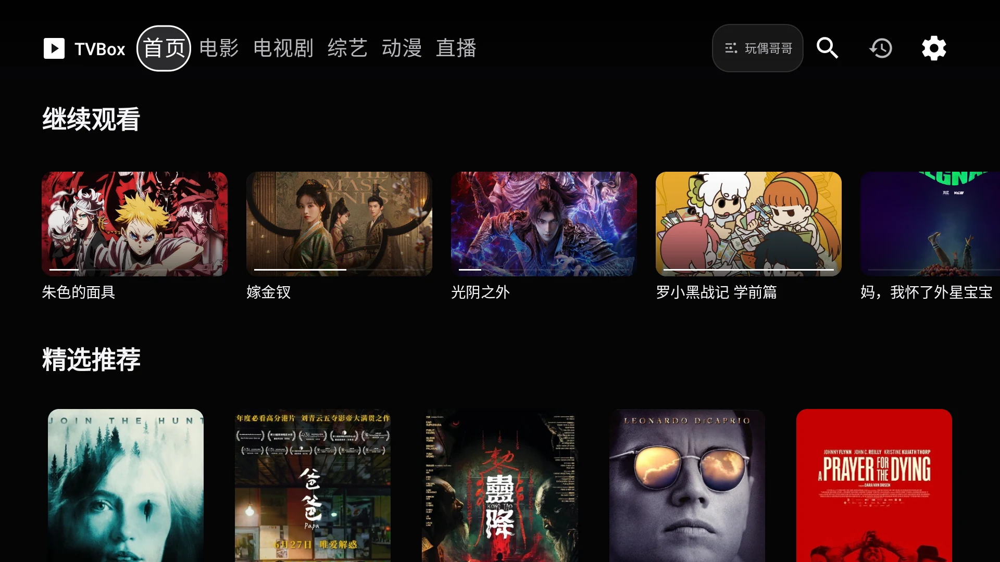

### 分类与悬浮筛选

选中电影、电视剧、综艺或动漫标题后，筛选图标会显示在当前标题旁。按确认键
打开贴近顶部导航的毛玻璃筛选层；资源列表保持在下层滚动，不会因展开筛选而
被向下推走。返回键或再次点击当前标题可以关闭。

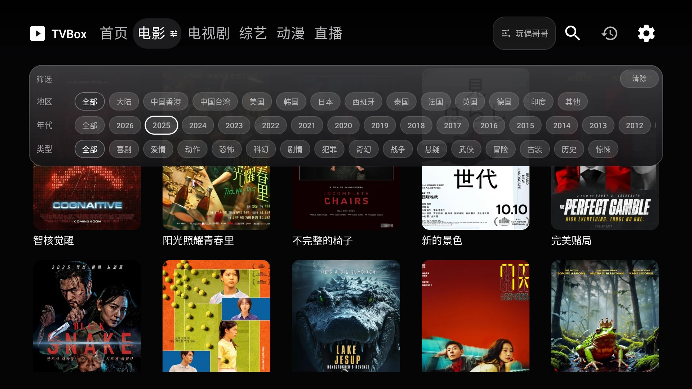

### 全源搜索与详情

搜索会并行查询当前配置中所有可搜索 Spider，不局限于当前选中片源。输入框支持
中文、全拼和拼音首字母联想，选择片名后对全源执行搜索。结果按片源分组，在搜索
页左侧选择片源后浏览该源的全部搜索结果。

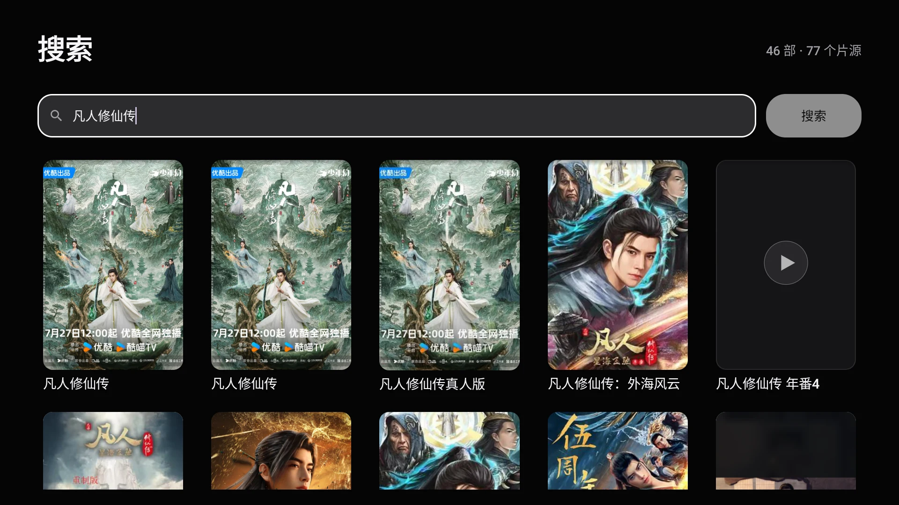

详情页将影片信息、线路和选集分区展示，选集列表可独立滚动和遥控器定位。

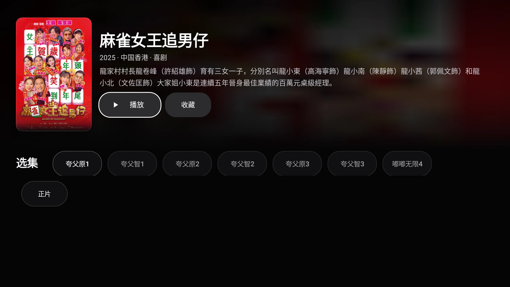

### 我的与网盘中心

收藏和播放记录使用一体化切换控件；网盘中心会动态识别配置源提供的品牌入口。

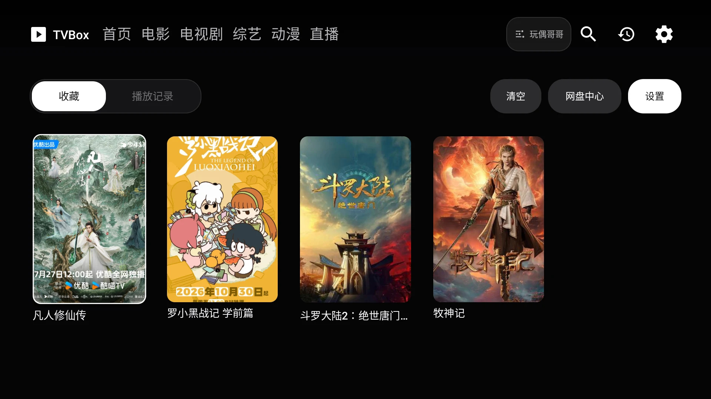

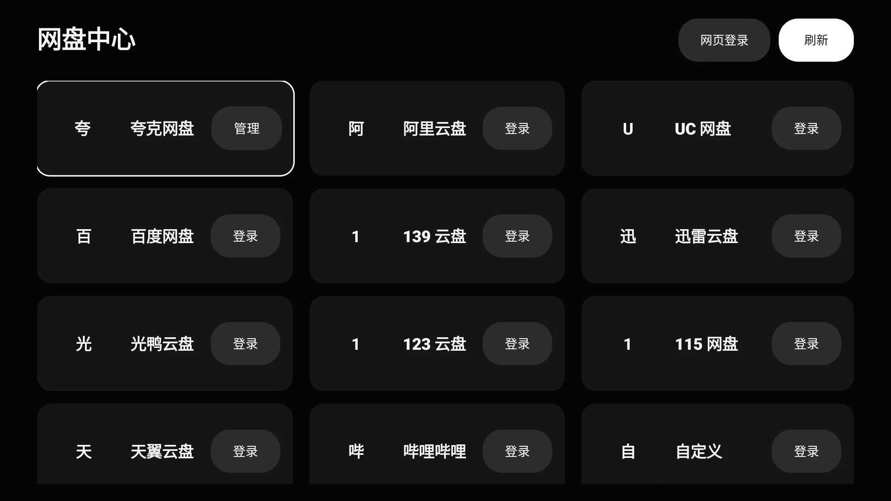

### 直播

直播列表使用自适应频道卡片，支持分组、封面、遥控器横向选台和播放器内切台。

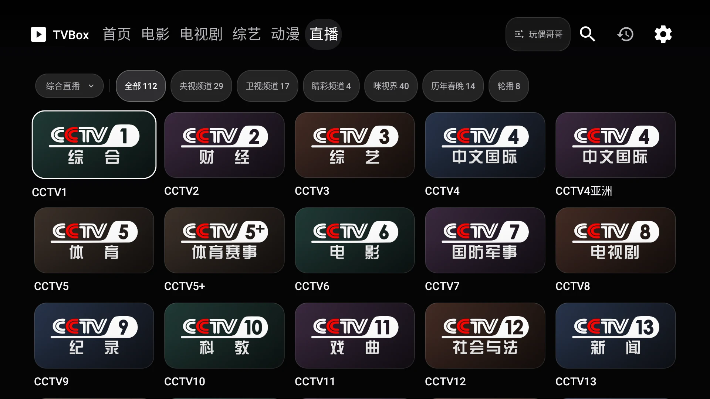

### 设置与播放器

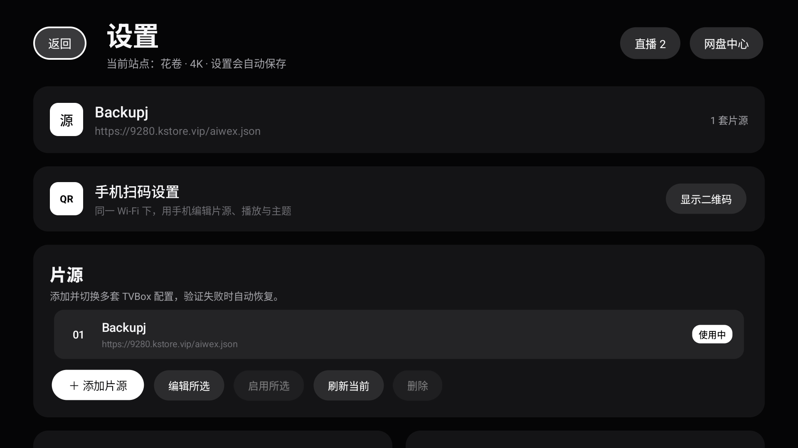

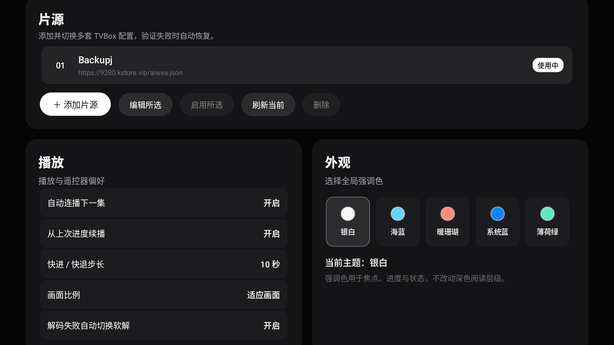

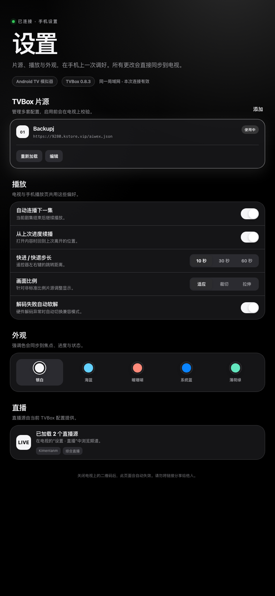

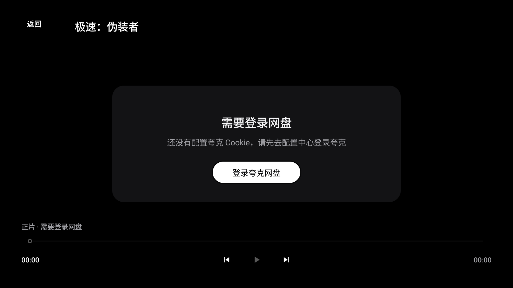

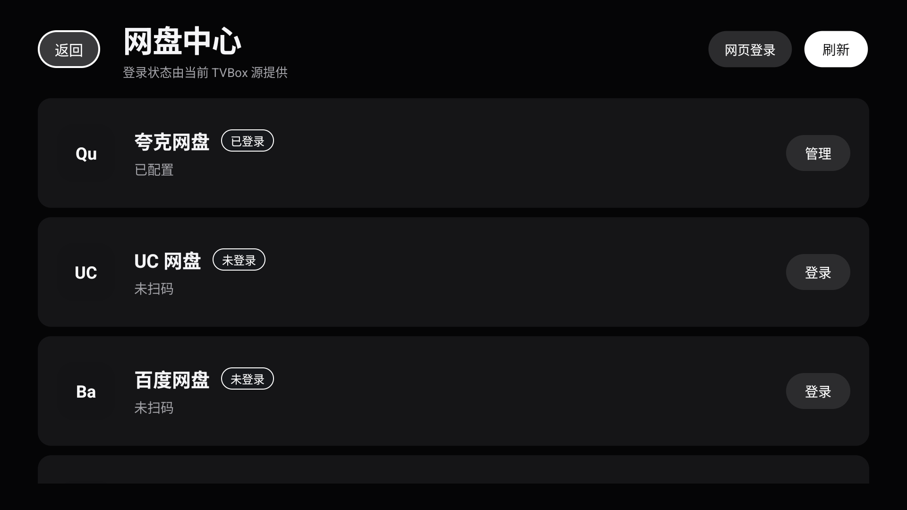

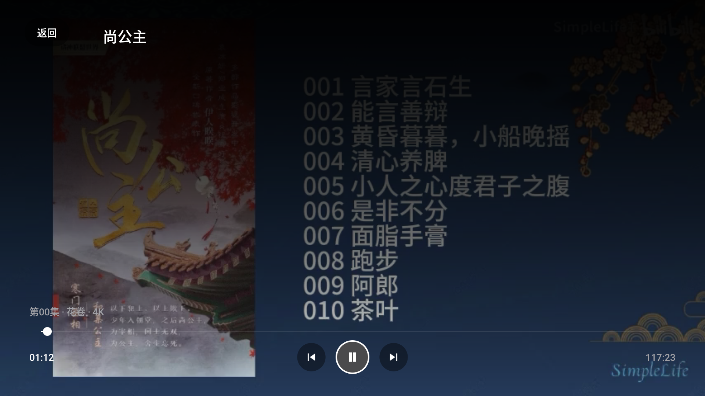

## 已实现

- TVBox JSON 配置加载、站点选择与本地配置持久化。
- Java Spider 独立进程、Binder ABI、代理网络和 JAR 加载。
- 首页推荐、真实历史“继续观看”、分类浏览、全源分组搜索、详情与线路/剧集解析。
- 分类标题集成筛选入口，使用毛玻璃悬浮筛选层，支持地区、年代、类型、类别等
  源提供的筛选项，并在卡片列表上方独立关闭或清空。
- 搜索覆盖所有可搜索 Spider，不限制快速搜索标记或前 8 个站点。
- ExoPlayer 播放、HLS/HTTP 数据源、上一集/下一集、断点续播；解码器异常时
  自动重建播放器并切换到系统软解。
- 收藏、播放历史、设置与片源切换。
- 直播中心：M3U/TXT/JSON 直播源、频道分组、多线路和遥控器切台。
- 局域网手机设置：电视显示二维码，手机编辑片源、播放偏好和主题。
- 网盘中心：夸克、阿里云盘、UC、百度、139、迅雷、光鸭、123、115、天翼、
  哔哩哔哩和自定义 AList/WebDAV 登录入口；配置中出现未知品牌时也会动态展示。
- 播放器会识别网盘 Cookie 状态，缺失时直接提供对应品牌的登录入口。
- 同一 Spider 站点的请求按站点串行执行，避免分类、详情和网盘解析并发时触发
  Java Spider 原生竞争导致崩溃。
- 遥控器 D-pad 焦点、焦点缩放、自动滚动和沉浸式全屏。
- 720p、1080p、4K、16:9、16:10、4:3 和 21:9 视口自适应；卡片列数、间距、
  字号、详情页、播放器控件与弹窗尺寸会随可用空间调整。
- 设置页提供 `0% / 2.5% / 5%` 画面安全边距，用于兼容不同电视的过扫描裁切。
- 标题/年份海报匹配，豆瓣候选与 Metahub 高清图补全；高清加载失败时
  自动回退片源原图。
- 低分辨率海报增强、环境背景降采样模糊、近黑底与白色焦点视觉层级。
- 主海报与详情海报底部透明渐隐，避免片源海报的黑边和硬切边。

## 构建

需要 JDK 21、Android SDK 37、Build Tools 37.0.0。

```bash
export ANDROID_HOME=/path/to/android-sdk
export ANDROID_SDK_ROOT="$ANDROID_HOME"
./gradlew clean testDebugUnitTest assembleRelease
```

生成的 Release 构建：

```text
app/build/outputs/apk/release/app-release.apk
```

本地构建后生成的分发文件：

```text
dist/TVBox-1.1.0-release.apk
dist/TVBox-1.1.0-release.apk.sha256
```

## 仓库结构

```text
app/      Android TV 客户端
catvod/   CatVod Java Spider ABI 兼容层
spider/   Spider JAR 与运行支撑模块
dist/     本地发布 APK 与 SHA-256 校验文件，不提交到 Git
docs/     设计、可行性文档与界面截图
tools/    构建和片源审计工具
source/   本地片源输入，不提交
work/     本地参考源码与审计临时文件，不提交
```

`dist/` 仅保存当前构建产物，APK 和校验文件通过 GitHub Release 分发，不进入
Git 历史。推送形如 `v1.1.0` 的版本标签后，GitHub Actions 会运行测试、构建
Release APK，并将 APK 和 SHA-256 文件附加到对应 Release。

## 安装

```bash
adb install -r dist/TVBox-1.1.0-release.apk
adb shell am start -n com.ch4nhm.tvapp/.MainActivity
```

最低系统版本为 Android 7.0（API 24）。当前分发包为 Release 构建，但为保证
现有设备可以覆盖升级，仍使用 Android 调试证书签名；公开生产分发前应配置并
替换为独立正式证书。

## 使用

1. 首次启动会加载默认 TVBox 配置，也可以在设置中更换为你有权使用的配置地址。
2. 从首页进入电影、电视剧、综艺或动漫分类；再次按确认键可展开或收起当前
   分类的悬浮筛选层。
3. 顶部搜索会并行查询当前配置中的所有可搜索 Java Spider 站点。
4. 在详情页选择播放线路和剧集。
5. 在“直播”中切换直播源、分组和频道，左右键可切换相邻频道。
6. 在“我的”中查看收藏、播放记录和网盘中心。
7. 在“设置 · 手机扫码设置”中打开二维码，用同一 Wi-Fi 下的手机继续编辑。

## 电视适配

应用不再把所有电视强制为同一个 `960 × 540dp` 设计尺寸。启动和窗口变化时会
读取当前窗口边界、系统栏安全区、逻辑密度、字体缩放和用户设置的安全边距，
再据此计算紧凑、常规和大屏三档布局参数。海报网格会在保证可读尺寸的前提下
自动调整列数和间距，详情页、直播、片库、设置、播放器和弹窗也使用同一套
尺寸模型。

可在“设置 · 画面安全边距”中按电视实际裁切情况选择安全边距。窄屏 4:3 设备
会优先保证内容与遥控器焦点可见，顶部片源快捷入口可能隐藏，仍可从设置页切换
片源。

## 片源说明

不同 TVBox 源返回的字段和可用能力差异很大。项目同时兼容标准
`vod_year/vod_area/type_name` 与网盘源常见的 `year/area/type` 字段。

部分源只返回网盘索引而不提供可直接播放的剧集。此时详情页会显示
“暂无可播线路”，不会展示空按钮或错误地进入播放器。

网盘登录入口会优先从 `Wexconfig`、`MDrive`、`PanConfigGuard` 等配置站点动态
发现，并兼容阿里云盘常见的 `alipan`、`aliyundrive`、`aliyun` 标识。夸克账号
的扫码登录、Cookie 持久化、Java 代理取流到播放器出画链路已完成实机验证；
阿里云盘及其他品牌是否可完成原生登录取决于当前配置源是否提供对应登录动作，
仍建议使用对应账号逐项验证。

## 已知限制

- 不内置、不保证任何第三方片源的可用性、内容或画质。
- 站点筛选器尚未完整覆盖所有 Spider 方言。
- Python/JS Spider 不在当前 ABI 兼容范围内。
- EPG 地址会被解析和保留，但目前没有节目单界面；部分公共 EPG 服务也会返回 403。
- 手机设置链接只在设置页可见期间开放，并使用一次性随机口令保护。
- Android 16 及以上首次使用手机设置时，需要允许 App 访问局域网设备。
- 部分源会返回自身域名不可用、空详情或错误元数据，需要切换片源。
- 自适应布局由单元测试覆盖常见分辨率、宽高比、安全区和字体比例；不同厂商的
  过扫描、系统栏与播放器缩放仍建议在目标电视上做最终视觉验收。

## 文档

- [可行性方案](docs/feasibility-plan.md)
- [UI 设计语言](docs/ui-design-language.md)

## 许可证

本项目以 [GNU General Public License v3.0](LICENSE) 发布。`catvod/` 中复用和
链接了 [FongMi/TV](https://github.com/FongMi/TV) 的 GPL-3.0 组件，来源与修订
说明见 `catvod/UPSTREAM.md`；AndroidX、Media3、Glide 等依赖遵循各自许可证。

仓库中的示例海报、影片截图和字体仅用于界面演示，其权利归原权利人所有，不在
本项目 GPL 授权范围内。详见 `NOTICE.md`。

仅接入你有权访问和使用的合法内容源。
