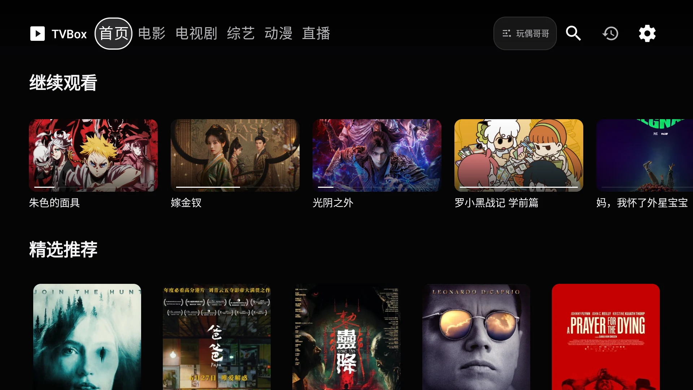

# UI 设计语言：tvOS Gallery

日期：2026-10-28
对应实现：`app/`（Android TV，Java + XML Views）

## 1. 视觉方向

界面参考 Apple TV / tvOS 的观看体验，但不直接复制系统界面：

- 以近黑背景、剧照和海报作为画面主体，控件退到内容之后
- 以白色和中性灰建立层级，不使用暖金、紫色渐变或装饰性花纹
- 标题使用系统无衬线字体，依靠字号、字重和留白建立电影感
- 大图优先、弱边框、少分隔线，避免传统 TVBox 工具面板观感
- 焦点缩放和短暂白色描边承担主要交互反馈

关键词：**Cinematic / Quiet / Image-first / Neutral / tvOS-like**

## 2. Design Tokens

| Token | 值 | 用途 |
|---|---|---|
| `bg.base` | `#050506` | 全局近黑背景 |
| `bg.elevated` | `#151517` | 浮层与内容卡片 |
| `bg.control` | `#2C2C2E` | 次级按钮 |
| `text.primary` | `#F5F5F7` | 主标题与主要文字 |
| `text.secondary` | `#A1A1A6` | 年份、类型和辅助说明 |
| `text.muted` | `#6E6E73` | 弱提示 |
| `nav.active` | `#FFFFFF` | 当前导航与主按钮 |
| `focus` | `#FFFFFF` | 焦点描边和焦点文字 |

主题设置保留银白、海蓝、暖珊瑚、系统蓝、薄荷绿五套强调色。默认银白主题
保持纯中性，其他颜色只影响强调色，不改变近黑阅读层级。

## 3. 字体与版式

设计基准为 1920×1080、density 2.0（960dp 宽）。

| 层级 | 字体 | 典型规格 |
|---|---|---|
| Hero 主标题 | `sans-serif-black` | 42sp，粗体 |
| 页面标题 | `sans-serif-black` | 32sp |
| 区块标题 | `sans-serif-medium` | 26sp |
| 卡片标题 | `sans-serif-medium` | 16sp |
| 必要辅助信息 | `sans-serif` | 15–17sp |

主要尺寸：

- 内容边距：40dp
- 顶部导航：96dp
- Hero：456dp 高
- 推荐卡片：136×204dp
- 主按钮高度：56dp；选集按钮高度：58dp
- 圆角：胶囊按钮 28dp，内容卡片 10–20dp
- 横向卡片间距：18dp

## 4. 组件规则

### 顶部导航

- 左侧为播放标志和 `TVBox` 字标
- 中部为首页、电影、电视剧、综艺、动漫、直播、我的
- 当前栏目使用白色胶囊和深色文字，焦点态使用同样的高对比胶囊
- 右侧为搜索、播放记录、设置和实时时钟

### Hero

- 全宽环境背景加纵向暗角，右侧保留竖版海报
- 左侧只保留主标题与核心动作，不显示来源、状态或宣传小字
- 白色“播放”是主动作，半透明“详情”是次动作
- 海报按标题、年份匹配高清图；失败时回退片源原图

### 内容卡片

- 图片优先，不常驻描边
- 标题放在图片外，不叠加片源角标、评分或宣传文案
- 焦点态放大 1.05–1.06，叠加 1.5dp 白色描边和轻微抬升
- 卡片容器必须允许焦点溢出，避免缩放后的左缘或上缘被裁切

### 按钮

- 主按钮：强调色填充（默认银白主题为白色）、对应前景色、播放图标
- 次按钮：`#2C2C2E` 填充、白色文字
- 焦点态：主按钮保持白色并轻微放大；次按钮显示 2dp 白色内描边
- 所有页面不显示返回按钮，统一依赖遥控器系统返回键
- 主操作按钮高度不低于 56dp，选集按钮不低于 58dp，确保远距离观看时易读易点
- 顶部工具条和按钮行设置 `clipChildren=false`，焦点放大不切边

### 详情、搜索、片库和设置

- 详情页为海报、标题、简介、播放/收藏、线路和剧集组成的单页结构
- 详情只展示剧情内容，不显示片源名称、线路数量或占位宣传语
- 搜索页使用大号输入框、片源选择栏和单源结果列表，结果继续复用内容卡片
- 片库用收藏/历史分段切换，空状态给出明确下一步
- 设置页使用无分组小标题的单列卡片，只保留片源管理、播放偏好、主题和手机/缓存入口
- 设置页不显示说明性副标题；片源地址是唯一保留的小号介绍文字
- 设置项行高 60dp，操作按钮高度 52dp、文字 16sp，片源与设置项主文字 17–18sp
- 所有内容页面保持同一近黑背景、40dp 安全边距和白色焦点语言
- 片源名称可出现在搜索页的片源选择栏和设置等管理场景，不叠加到内容卡片上

### 直播

- 顶部导航已经标识当前栏目，内容区不再重复显示“直播”标题
- 不显示直播源格式、当前分组或频道宣传副标题
- 页面按“直播源、分组、频道”建立三级轻量导航
- 频道卡片以呼号作为主视觉，弱化低清台标图片，避免源图片模糊影响观感
- 频道搜索和分组筛选始终保留遥控器焦点，列表自动滚动到首个结果
- 播放器控制层使用独立直播状态，左右键切台，不混入点播历史与选集

### 手机设置

- 电视端以二维码卡片承载入口，只在设置页打开期间启动局域网服务
- 手机页使用 iOS 分组卡片、原生开关、分段控件和大标题排版
- 支持片源增删/编辑/启用、播放偏好和主题颜色，保存后电视端即时刷新
- 手机页跟随系统深色模式，并用当前主题色关联状态和主要操作

### 播放器

- 视频全屏，控制层使用轻量渐变，不遮挡主体画面
- 顶部只保留播放状态和标题，底部使用半透明圆角控制面板承载进度与选集操作
- 不显示返回按钮，使用遥控器系统返回键退出播放器
- SeekBar、播放按钮和状态操作均支持纯遥控器操作
- 解析失败、网盘未登录、自动连播关闭使用独立状态面板

## 5. 动效与焦点

- 按钮焦点缩放：约 1.04，150–180ms
- 卡片焦点缩放：约 1.05–1.06，180ms
- 焦点移动不使用弹跳、旋转或持续呼吸动画
- 页面首屏可以使用一次短暂淡入，列表项不做无意义的逐项延迟
- 焦点必须始终可见，并会自动滚动到可视区域
- 缩放控件的外层容器不得裁剪焦点溢出
- 纯遥控器应能完成首页、搜索、详情、播放、收藏、历史和设置操作

## 6. 实现位置

- 首页：`app/src/main/java/com/ch4nhm/tvapp/MainActivity.java`
- 详情：`app/src/main/java/com/ch4nhm/tvapp/DetailActivity.java`
- 播放器：`app/src/main/java/com/ch4nhm/tvapp/PlayerActivity.java`
- 设置：`app/src/main/java/com/ch4nhm/tvapp/SettingsActivity.java`
- 直播：`app/src/main/java/com/ch4nhm/tvapp/LiveActivity.java`
- 直播播放器：`app/src/main/java/com/ch4nhm/tvapp/LivePlayerActivity.java`
- 手机设置服务：`app/src/main/java/com/ch4nhm/tvapp/LanSettingsServer.java`
- 手机设置页面：`app/src/main/res/raw/lan_settings.html`
- 焦点动效：`app/src/main/java/com/ch4nhm/tvapp/FocusAnimator.java`
- Hero：`app/src/main/res/layout/item_hero.xml`
- 推荐卡片：`app/src/main/res/layout/item_poster_card.xml`
- 详情布局：`app/src/main/res/layout/activity_detail.xml`
- 设置布局：`app/src/main/res/layout/activity_settings.xml`
- Design tokens：`app/src/main/res/values/colors.xml`、`dimens.xml`

## 7. 当前截图

- 首页焦点态：`docs/screenshots/home.webp`
- 设置页：`docs/screenshots/settings.png`
- 直播页：`docs/screenshots/live.webp`
- 手机设置：`docs/screenshots/remote-settings.png`

## 8. 当前边界

- TVBox 配置返回的海报质量差异很大；高清图补全失败时会使用片源原图
- 网盘页面的可见能力取决于当前 TVBox 源是否包含网盘相关 Spider
- 搜索、详情和播放可用性取决于第三方源本身，项目不内置内容源
- XML/View 实现优先保证 Android TV 兼容性和遥控器性能
